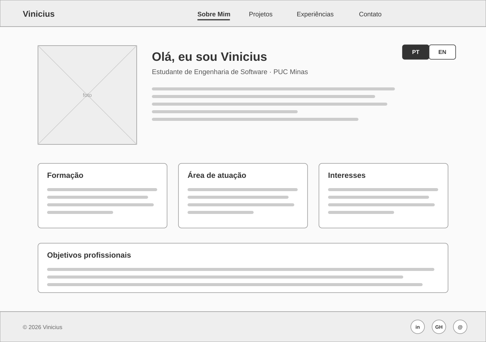
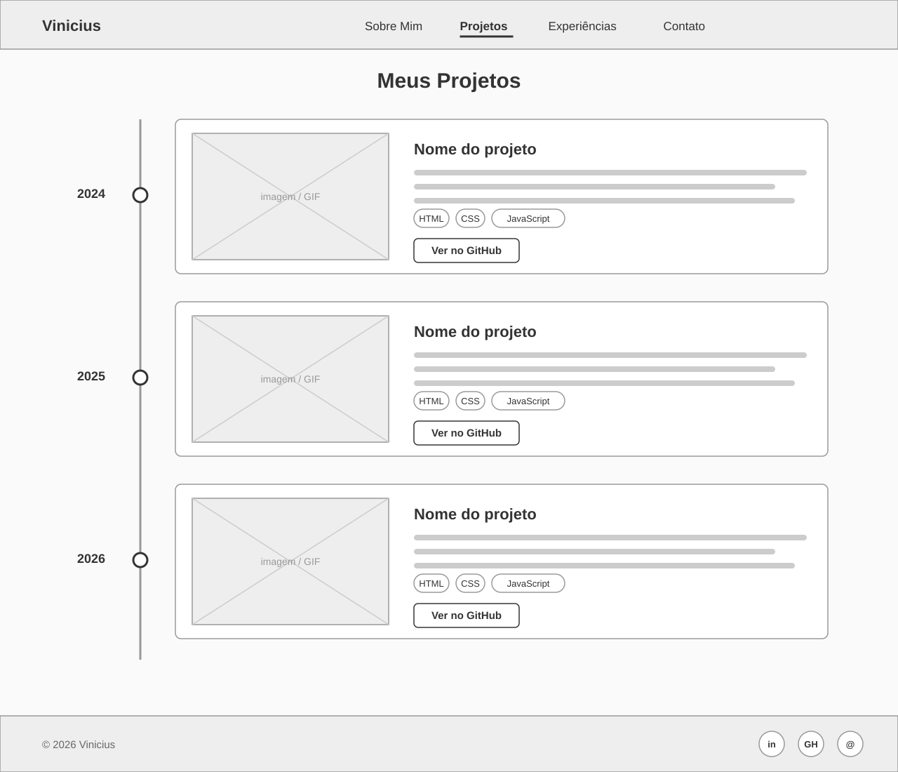
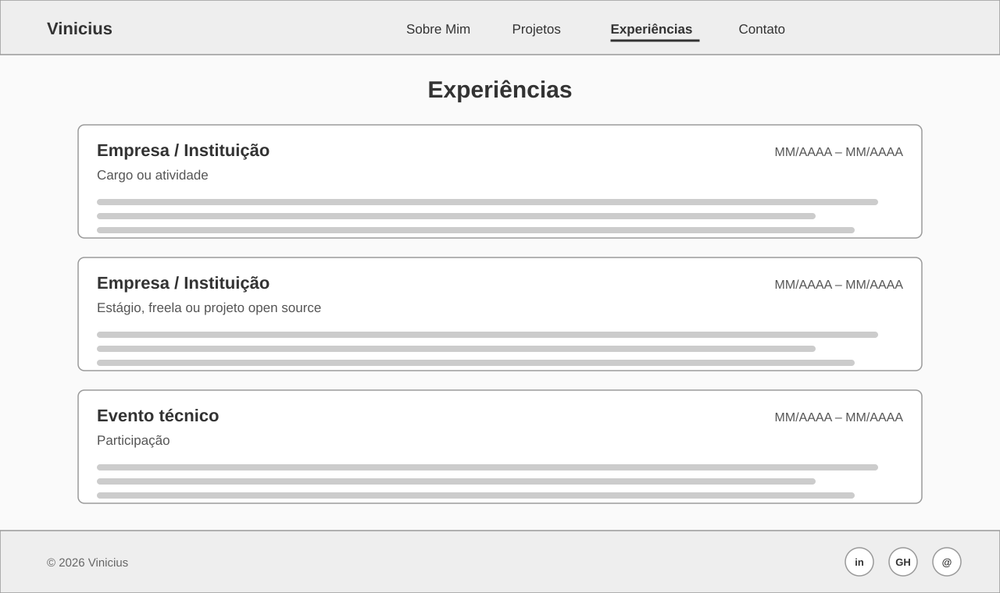
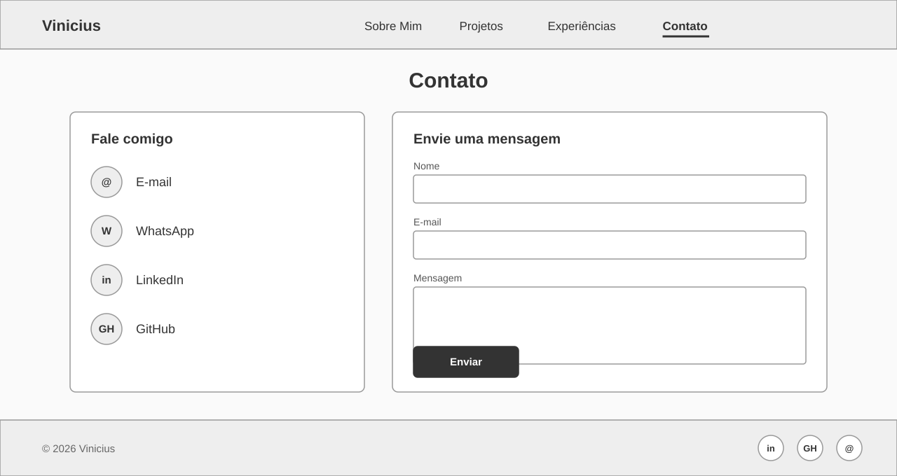

# Portfólio Profissional — Vinicius

Website de portfólio profissional para apresentar minha trajetória, projetos, experiências e formas de contato, de maneira moderna, responsiva e bilíngue (PT/EN).

> Trabalho do **Laboratório 01** da disciplina **DIAW** (Desenvolvimento e Integração de Aplicações Web) — Engenharia de Software, PUC Minas.

🔗 **Site publicado:** _[EDITAR: cole aqui o link da Vercel/Render quando fizer o deploy]_

## Sumário

- [Funcionalidades](#funcionalidades)
- [Protótipos (wireframes)](#protótipos-wireframes)
- [Tecnologias utilizadas](#tecnologias-utilizadas)
- [Dependências](#dependências)
- [Estrutura de diretórios](#estrutura-de-diretórios)
- [Como executar localmente](#como-executar-localmente)
- [Configurando o envio de e-mail (EmailJS)](#configurando-o-envio-de-e-mail-emailjs)
- [Como personalizar o conteúdo](#como-personalizar-o-conteúdo)
- [Deploy](#deploy)

## Funcionalidades

- **Sobre Mim:** apresentação em português e inglês (botões PT/EN), com formação, área de atuação, interesses e objetivos.
- **Projetos:** linha do tempo do mais antigo ao mais recente. Cada projeto tem nome, descrição, tecnologias, link do GitHub e imagem/GIF.
- **Experiências:** estágios, freelas, projetos open source e eventos técnicos, com instituição, cargo/atividade, período e descrição.
- **Contato:** ícones clicáveis (e-mail, WhatsApp, LinkedIn, GitHub) e formulário (nome, e-mail, mensagem) com validação e envio por e-mail.
- Design responsivo (menu lateral no celular), navegação por teclado e rodapé com redes sociais.

## Protótipos (wireframes)

Wireframes de média fidelidade feitos no Figma:

| Sobre Mim | Projetos |
|---|---|
|  |  |

| Experiências | Contato |
|---|---|
|  |  |

## Tecnologias utilizadas

- [React](https://react.dev/) — construção da interface
- [Vite](https://vite.dev/) — servidor de desenvolvimento e build
- [Material UI (MUI)](https://mui.com/material-ui/) — componentes de interface
- [React Router](https://reactrouter.com/) — navegação entre as páginas
- [EmailJS](https://www.emailjs.com/) — envio de e-mail direto do front-end
- [Figma](https://www.figma.com/) — wireframes
- [Vercel](https://vercel.com/) — hospedagem
- Git e GitHub — versionamento

## Dependências

| Pacote | Para que serve |
|---|---|
| `react`, `react-dom` | Biblioteca de interface |
| `react-router-dom` | Rotas (páginas) do site |
| `@mui/material`, `@emotion/react`, `@emotion/styled` | Componentes MUI e seu sistema de estilos |
| `@mui/icons-material` | Ícones (menu, e-mail, WhatsApp, LinkedIn, GitHub) |
| `@emailjs/browser` | Envio do formulário por e-mail |
| `@fontsource-variable/space-grotesk`, `@fontsource/source-sans-3` | Fontes (títulos e texto), servidas pelo próprio site |
| `vite`, `@vitejs/plugin-react` _(dev)_ | Ferramentas de build e desenvolvimento |

## Estrutura de diretórios

```
portfolio/
├── docs/wireframes/        # Wireframes das 4 páginas
├── public/
│   ├── favicon.svg
│   └── images/             # Foto e imagens/GIFs dos projetos
├── src/
│   ├── components/         # Header, Footer, Layout, ImageWithFallback
│   ├── data/               # SEU CONTEÚDO: profile.js, projects.js, experiences.js
│   ├── i18n/               # Idiomas (PT/EN): translations.js e LanguageContext.jsx
│   ├── pages/              # About, Projects, Experiences, Contact
│   ├── App.jsx             # Definição das rotas
│   ├── main.jsx            # Ponto de entrada
│   └── theme.js            # Cores e tipografia
├── .env.example            # Modelo das variáveis do EmailJS
├── index.html
├── package.json
├── vercel.json             # Faz as rotas funcionarem na Vercel
└── vite.config.js
```

## Como executar localmente

Pré-requisito: [Node.js](https://nodejs.org/) instalado.

```bash
# 1. Clone o repositório
git clone https://github.com/SEU-USUARIO/portfolio.git
cd portfolio

# 2. Instale as dependências
npm install

# 3. (Opcional) configure o e-mail — veja a seção abaixo
cp .env.example .env

# 4. Rode o site
npm run dev
```

Abra o endereço mostrado no terminal (geralmente `http://localhost:5173`).

Outros comandos: `npm run build` (gera a versão de produção em `dist/`) e `npm run preview` (testa essa versão localmente).

## Configurando o envio de e-mail (EmailJS)

1. Crie uma conta gratuita em [emailjs.com](https://www.emailjs.com/).
2. Em **Email Services**, conecte o seu e-mail e anote o **Service ID**.
3. Em **Email Templates**, crie um template usando estas variáveis no corpo: `{{name}}`, `{{email}}` e `{{message}}`. Em "To Email", coloque o e-mail que vai receber as mensagens; em "Reply To", use `{{email}}`. Anote o **Template ID**.
4. Em **Account**, copie a **Public Key**.
5. Preencha o arquivo `.env`:

```
VITE_EMAILJS_SERVICE_ID=seu_service_id
VITE_EMAILJS_TEMPLATE_ID=seu_template_id
VITE_EMAILJS_PUBLIC_KEY=sua_public_key
```

O arquivo `.env` não vai para o GitHub. Na Vercel, cadastre as mesmas três variáveis em **Settings → Environment Variables**.

## Como personalizar o conteúdo

Todo o conteúdo fica em `src/data/` (procure por `[EDITAR]`):

- `profile.js`: nome, contatos, foto e textos da página Sobre Mim (em PT e EN).
- `projects.js`: lista de projetos. Coloque as imagens/GIFs em `public/images/`.
- `experiences.js`: lista de experiências.

## Deploy

O site é publicado na **Vercel** a partir deste repositório:

1. Em [vercel.com](https://vercel.com/), clique em **Add New → Project** e importe o repositório.
2. A Vercel detecta o Vite sozinha (build: `npm run build`, saída: `dist`).
3. Cadastre as variáveis do EmailJS e clique em **Deploy**.
4. Cole o link gerado no topo deste README.
